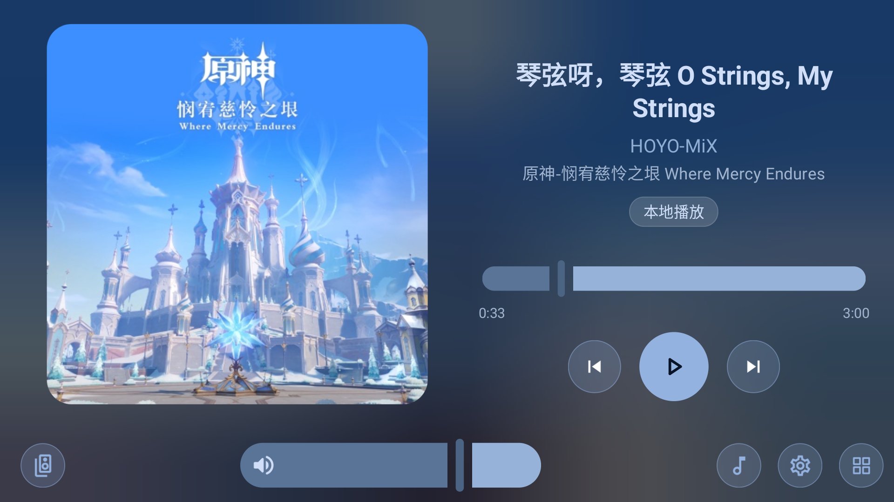
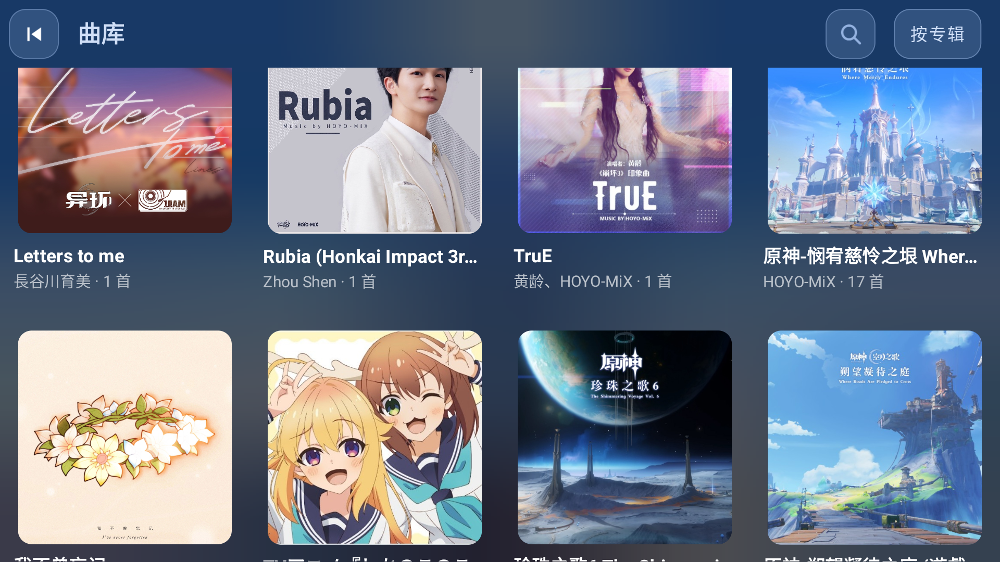
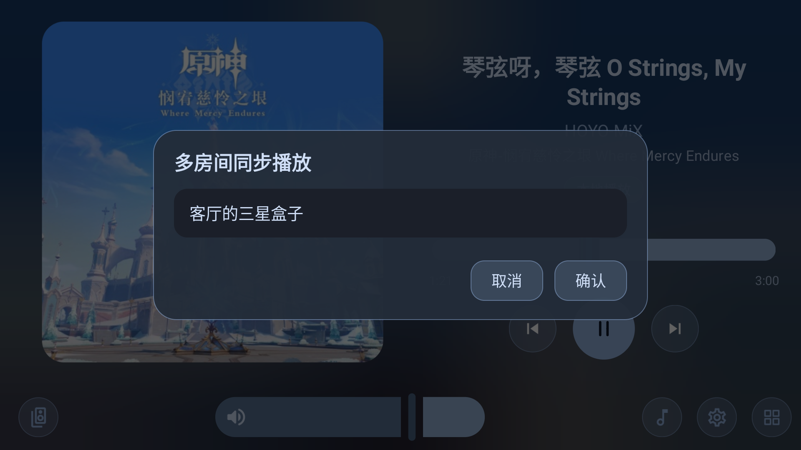
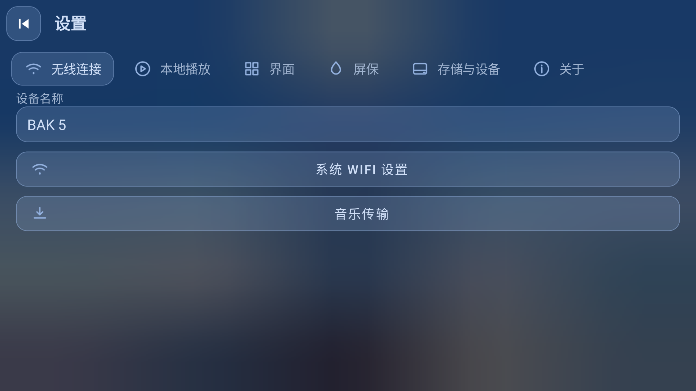

<h1 align="center">BukaMusic</h1>

<p align="center"></p>

<p align="center">安卓音乐播放器：本地音乐 / AirPlay 接收 / 多房间同步 / 歌词动画 / 屏保时钟</p>

<p align="center">下载：<a href="https://github.com/HAN-BAK/BukaMusic/releases">Releases</a>（Android 6.0+）</p>

## 功能

### 播放界面



- 本地音乐、AirPlay 投送、多房间同步三种播放源共用同一套播放控制；
- 专辑封面模糊背景，界面颜色随封面动态取色；
- 播放方式：顺序播放、顺序循环、随机循环、单曲循环；
- 左右声道平衡、10 段均衡器（预设可保存 / 导入 / 导出）；
- 本地切歌 1000ms 淡出 + 1000ms 淡入，快速连点直接切到目标歌曲；
- 底栏：多房间、系统音量滑条、曲库、设置、应用列表。

### 曲库



- 音乐路径可添加多条：本地目录、U 盘，以及 **WebDAV / SMB / FTP** 网络存储；
- 按歌曲、专辑、歌手浏览；打开曲库自动定位到正在播放的歌曲；
- 支持搜索、上传音乐、多选删除（网络存储中的歌曲不可删除）；
- 专辑内按音轨号排序，缺封面的歌曲显示统一占位图。

### AirPlay

- AirPlay 1（RAOP）：iPhone / iPad / Mac 控制中心可直接发现并投送；
- 投送时可用本机按钮遥控手机暂停、继续、上一曲、下一曲；
- 可开关「用 iPhone 音量键调节本机音量」；
- 投送期间封面、歌名、歌词自动同步显示。

### 多房间同步



- 主控把本地音乐同步到同一局域网内的其它 BukaMusic 设备；
- 时钟对齐 + 自动校准，长时间播放不漂移；
- 接收端可以控制主控的播放 / 暂停 / 切歌 / 进度；
- AirPlay 抢占时自动断开 / 恢复多房间播放。

### 歌词


- 商籁（sonnet）风格歌词动画：逐词高亮、镜头位移、间奏三点；
- 支持全屏镜头畸变、模糊、色散等特效；
- 自动匹配在线歌词（网易云 / LRCLIB），无词级时间戳时自动补全；
- 单击显示 / 隐藏控件，双击左侧 / 中间 / 右侧分别为上一曲 / 暂停 / 下一曲。

### 屏保


- 播放界面整页上滑进入，时间铺满屏幕，颜色跟随封面；
- 冒号渐隐渐显（可关闭）、24 小时制、5 款 Moven 字体；
- 未播放音乐时可设置闲置自动进入屏保。

### 设置与更新



- 四语言：中文 / English / 日本語 / 한국어；
- 音乐路径、网络曲库、播放方式、均衡器、屏保、后台运行、诊断；
- 启动时自动检查更新（每天一次），设置 → 关于 → 检查更新 可手动检查；
- 音乐传输：扫码或浏览器打开 `http://设备IP:端口` 上传歌曲；
- 可设为桌面（HOME）应用，像桌面一样直接启动。

## 使用方法

1. 安装后首次启动授予「音乐和音频」读取权限。
2. 设置 → 音乐路径：选择本地音乐文件夹；需要 NAS 时点「添加网络路径」，填写
   WebDAV / SMB / FTP 地址与账号。
3. 曲库选歌开始播放；播放页点击封面进入歌词，整页上滑进入屏保。
4. AirPlay：手机控制中心选择本机名称即可投送。
5. 多房间：底栏左侧「多房间」→ 勾选设备 → 确认；接收端会自动进入同步播放。
6. 更新：设置 → 关于 → 检查更新，或等待启动时自动提示。

## 构建方法

环境：JDK 21、Android SDK 34、Gradle（仓库自带 wrapper）。

```bash
./gradlew :app:assembleRelease
```

产物：`app/build/outputs/apk/release/app-release.apk`。

release 默认使用 `~/.android/debug.keystore` 签名（与 Android Studio 生成的一致）；
要使用自己的签名，修改 `app/build.gradle` 里的 `signingConfigs.release` 即可。
